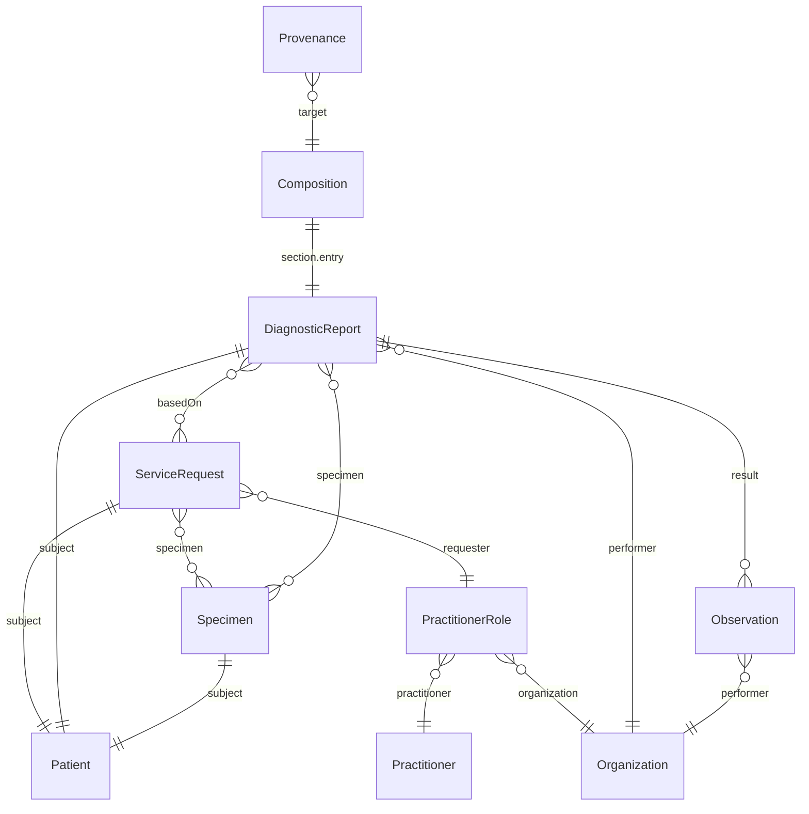

<b>Draft.</b> This implementation guide is a draft for discussion. It is <b>not</b> an
authoritative source and is not endorsed by NHS England, IHE or HL7. Check the cited
sources before using it for implementation.

The FHIR profiles in this guide describe one laboratory content model, used in FHIR
Messages (the HL7 v2 equivalent) and FHIR Documents (the NHS England national route).

### Model

### Profiles

| Profile | Resource | Parent | HL7 v2 | Notes |
|---|---|---|---|---|
| [Patient](StructureDefinition-Patient.html) | Patient | HL7 Europe `patient-eu-core` | PID | From the NW GMSA IG |
| [Laboratory Order](StructureDefinition-LaboratoryOrder.html) | ServiceRequest | HL7 Europe `ServiceRequest-eu-lab` | ORC, OBR (OML), TQ1 | |
| [Specimen](StructureDefinition-Specimen.html) | Specimen | HL7 Europe `Specimen-eu-lab` | SPM | |
| [Laboratory Report](StructureDefinition-LaboratoryReport.html) | DiagnosticReport | HL7 Europe `diagnosticReport-eu-core` | OBR (ORU) | See below |
| [Laboratory Result](StructureDefinition-LaboratoryResult.html) | Observation | HL7 Europe `Observation-resultslab-eu-lab` | OBX | |
| [Organization](StructureDefinition-Organization.html) | Organization | HL7 Europe `organization-eu-core` | XON, MSH-4 / MSH-6 | ODS code |
| [Practitioner](StructureDefinition-Practitioner.html) | Practitioner | HL7 Europe `practitioner-eu-core` | XCN | GMC / NMC / HCPC / GMP |
| [PractitionerRole](StructureDefinition-PractitionerRole.html) | PractitionerRole | HL7 Europe `practitionerRole-eu-core` | ORC-12 + ORC-21, PV1-8 + PV1-3 | |
| [Laboratory Report Composition](StructureDefinition-LaboratoryReportComposition.html) | Composition | HL7 Europe `Composition-eu-lab` | - | Document only |
| [Laboratory Report Provenance](StructureDefinition-LaboratoryReportProvenance.html) | Provenance | Provenance | - | Document only (NHS England) |
| [Bundle - Laboratory Report Document](StructureDefinition-BundleLaboratoryReportDocument.html) | Bundle | HL7 Europe `Bundle-eu-lab` | - | NHS England API |
| [MessageHeader](StructureDefinition-MessageHeader.html) | MessageHeader | MessageHeader | MSH, MSA | From the NW GMSA IG |
| [Bundle - FHIR Messaging](StructureDefinition-BundleMessage.html) | Bundle | Bundle | the message | From the NW GMSA IG |
{:.grid}

Identifier data types ([NHS Identifier](StructureDefinition-NHSIdentifier.html),
[Medical Record Number](StructureDefinition-MedicalRecordNumber.html),
[Organisation Code](StructureDefinition-OrganisationCode.html),
[Order Identifier](StructureDefinition-OrderIdentifier.html),
[Report Identifier](StructureDefinition-ReportIdentifier.html),
[Accession Identifier](StructureDefinition-AccessionIdentifier.html) and others) are copied
from the NW GMSA IG, so identifiers are filled in the same way across the NW GMSA, Imaging,
Cancer Pathology Report and this guide.

### Why These Parents

- **HL7 Europe Laboratory Report** is the base of the NHS England Pathology FHIR IG (its
  Composition, DiagnosticReport and ServiceRequest profiles are EU Laboratory profiles),
  so this guide uses it too
- **DiagnosticReport** - HL7 Europe `DiagnosticReport-eu-lab` requires the R5
  `DiagnosticReport.composition` extension, so every report must belong to a Composition.
  That suits a document but not a FHIR Message (or a RESTful DiagnosticReport), so the
  [Laboratory Report](StructureDefinition-LaboratoryReport.html) is derived from EU Core
  `diagnosticReport-eu-core`, as the NW GMSA IG's report is. In a document the report
  **SHALL** also meet `DiagnosticReport-eu-lab` - see the
  [document example](Bundle-LaboratoryReportDocumentFBC.html). NHS England uses a
  locally amended `DiagnosticReport-eu-lab` (`2.0.0-nhs-fix`), probably for a similar
  reason (**To confirm**)
- **No UK Core dependency** - HL7 Europe Laboratory restricts its references to HL7
  Europe Core profiles (Patient, Practitioner, PractitionerRole, Organization), so this
  guide uses those. NHS England uses UK Core for Practitioner, PractitionerRole and
  Organization; the content (identifiers) is the same, but the `meta.profile` differs -
  see [Pathology Laboratory Reporting API](PathologyReportingAPI.html#profiles)

### Relationship to Other Guides

| Guide | Relationship |
|---|---|
| [NHS England Pathology FHIR IG](https://simplifier.net/guide/pathology-fhir-implementation-guide) | The national FHIR Document for primary care. This guide aligns its Document profiles with it and adds the HL7 v2 and FHIR Message forms |
| [HL7 Europe Laboratory Report](https://hl7.eu/fhir/laboratory/) | Parent of most profiles |
| [NW GMSA FHIR IG](https://nw-gmsa.github.io/en/) | Same IHE LTW / ILW approach and HL7 v2 conventions, for genomics. Data types, Patient and messaging profiles are copied from it |
| [Cancer Pathology Report](https://kevinmayfield.github.io/CancerPathologyReport/) | Cellular pathology (out of scope here) |
| [HL7 v2 to FHIR](https://build.fhir.org/ig/HL7/v2-to-fhir/) | Basis of the [mapping](mapping.html) |
{:.grid}
