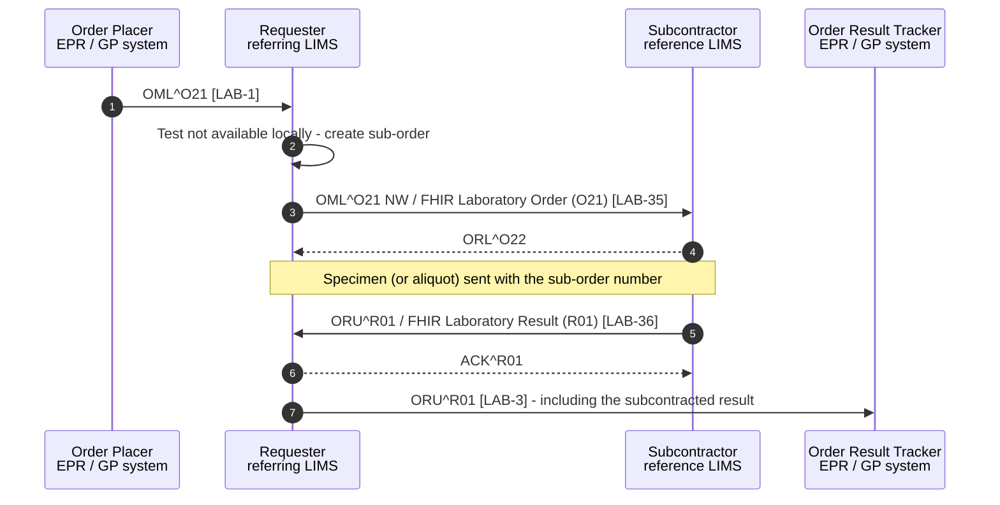

<b>Draft.</b> This implementation guide is a draft for discussion. It is <b>not</b> an
authoritative source and is not endorsed by NHS England, IHE or HL7. Check the cited
sources before using it for implementation.

The IHE PaLM **Inter-Laboratory Workflow (ILW)** profile covers one laboratory (the
*Requester*) sub-contracting tests to another (the *Subcontractor*), and the results
coming back. The Requester stays responsible for the order: it reports the results
(including the subcontracted ones) to the Order Result Tracker.

### References

- [IHE PaLM TF-1](https://www.ihe.net/resources/technical_frameworks/#PaLM) - Inter-Laboratory Workflow (ILW)
- [IHE PaLM TF-2](https://www.ihe.net/resources/technical_frameworks/#PaLM) - transactions LAB-35, LAB-36
- [NW GMSA - Inter Laboratory Workflow (ILW)](https://nw-gmsa.github.io/en/ILW.html) - the genomics equivalent

### Where ILW Applies in England

- **Pathology networks** - English pathology services are organised into regional
  networks, often hub and spoke: an essential services laboratory at each hospital and
  a hub laboratory for non-urgent and specialist work. Where hub and spoke use
  different LIMS (or different instances), work moves between them as sub-orders
- **Specialist and reference laboratories** - tests a laboratory does not offer are
  referred to another NHS or independent laboratory, for example specialist
  immunology, rare metabolic tests or reference microbiology
- **Genomics** - a pathology laboratory sending a specimen to a Genomic Laboratory Hub
  (see the [NW GMSA FHIR IG](https://nw-gmsa.github.io/en/))

### Process Flow

### Rules

- The Requester is the **Order Placer** of the sub-order: the sub-order has its own
  Placer Order Number (assigned by the Requester) and Filler Order Number (assigned by
  the Subcontractor)
- The original order is carried as the parent: HL7 v2 ORC-8 / OBR-29 Parent; FHIR
  `ServiceRequest.basedOn`
- The Subcontractor is the performing laboratory of its results: HL7 v2 OBX-23
  Performing Organization Name (with OBX-24 / OBX-25 where the receiving system needs
  them); FHIR `Observation.performer`. When the Requester forwards these results in
  LAB-3 it **SHALL** keep the Subcontractor as the performer, so the report shows who
  did the test (a UKAS accreditation requirement - **To confirm** the exact clause)
- The patient identifiers in the sub-order are those known to the Requester. A
  Subcontractor **SHOULD NOT** assume an MRN from another trust is meaningful locally;
  the NHS Number is the shared identifier
