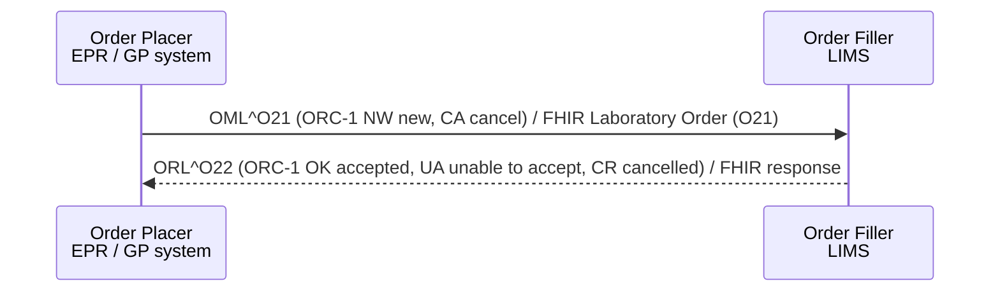

<div class="alert alert-danger" role="alert">
<b>Draft.</b> This implementation guide is a draft for discussion. It is <b>not</b> an
authoritative source and is not endorsed by NHS England, IHE or HL7. Check the cited
sources before using it for implementation.
</div>

**Placer Order Management [LAB-1]** - the Order Placer (EPR, order comms, GP system)
sends a new order to the Order Filler (LIMS), and may later cancel it. The Order
Filler accepts or rejects it.

### References

- [IHE PaLM TF-2](https://www.ihe.net/resources/technical_frameworks/#PaLM) - Placer Order Management [LAB-1]
- [NW GMSA - OML_O21 Laboratory Order](https://nw-gmsa.github.io/en/hl7v2.html#oml_o21-laboratory-order)
- [HL7 v2-to-FHIR - OML_O21 to Bundle](https://build.fhir.org/ig/HL7/v2-to-fhir/ConceptMap-message-oml-o21-to-bundle.html)

### Interaction



### HL7 v2.5.1 Message - OML^O21

| Segment | Optionality | Notes | FHIR |
|---|---|---|---|
| [MSH](hl7v2.html#msh) | 1..1 | | [MessageHeader](StructureDefinition-MessageHeader.html) |
| [PID](hl7v2.html#pid) | 1..1 | | [Patient](StructureDefinition-Patient.html) |
| [PV1](hl7v2.html#pv1) | 0..1 | Requesting location (PV1-3) and clinician (PV1-8); PV1-19 visit number if known | `ServiceRequest.encounter`, `requester` |
| **ORDER** | 1..* | One per test or panel | |
| - [ORC](hl7v2.html#orc) | 1..1 | | [Laboratory Order](StructureDefinition-LaboratoryOrder.html) |
| - [TQ1](hl7v2.html#tq1) | 0..1 | Priority. No TQ1 means routine | `ServiceRequest.priority` |
| - **OBSERVATION REQUEST** | 1..1 | | |
| -- [OBR](hl7v2.html#obr) | 1..1 | | [Laboratory Order](StructureDefinition-LaboratoryOrder.html) |
| -- [NTE](hl7v2.html#nte) | 0..* | Clinical details (NTE-2 = `P`) | `ServiceRequest.note` |
| -- [DG1](hl7v2.html#dg1) | 0..* | | `ServiceRequest.reasonCode` |
| -- **OBSERVATION** | 0..* | Ask at order entry answers (IHE LCSD) | `ServiceRequest.supportingInfo` → Observation or QuestionnaireResponse |
| --- [OBX](hl7v2.html#obx) | 1..1 | | |
| - **SPECIMEN** | 0..* | Specimen collected by the Order Placer | |
| -- [SPM](hl7v2.html#spm) | 1..1 | | [Specimen](StructureDefinition-Specimen.html) |
{:.grid}

### FHIR Message

The FHIR equivalent is the [Laboratory Order (O21)](MessageDefinition-laboratory-order.html)
message: a [Bundle Message](StructureDefinition-BundleMessage.html) whose
[MessageHeader](StructureDefinition-MessageHeader.html) has `eventCoding` v2-0003 `O21`
and focus the [Laboratory Order](StructureDefinition-LaboratoryOrder.html)(s). `ORL^O22`
is a FHIR response message (`MessageHeader.response`). Order control (ORC-1) maps to
`ServiceRequest.status` - see [v2-0119-to-request-status](ConceptMap-v2-0119-to-request-status.html).

### Example

A GP requests a full blood count.

```
MSH|^~\&|GPSYSTEM|A12345|LIMS|R0A|20261103091005||OML^O21^OML_O21|GP-MSG-000501|P|2.5.1|||AL
PID|1||633^^^R0A^MR~9449305552^^^NHS^NH||CHISLETT^Octavia^^^Miss||20080920|F|||1 RAVENSFIELD GARDENS^^EPSOM^SURREY^KT19 0ST|||||||||||||||||||||01
PV1|1|O|^^^^^^^^Example Surgery^A12345|||||G1234567^GREEN^Alex^^^Dr^^^GMP^^^^DN
ORC|NW|GP-ORD-000123^GPSYSTEM||GP-REQ-000045^GPSYSTEM|||||20261103091000|||G1234567^GREEN^Alex^^^Dr^^^GMP^^^^DN|||||||||Example Surgery^^^^^^^^^A12345
TQ1|1||||||||R^Routine^HL70485
OBR|1|GP-ORD-000123^GPSYSTEM||26604007^Complete blood count^SCT||||||||||||G1234567^GREEN^Alex^^^Dr^^^GMP^^^^DN|||||||||||||||^Tiredness
NTE|1|P|Tired all the time for 3 months. ? anaemia
SPM|1|GP-SPC-000123&GPSYSTEM||119297000^Blood specimen^SCT|||||||||||||20261103091500
```

FHIR equivalent: [Bundle Message - Laboratory Order (O21)](Bundle-LaboratoryOrderMessage.html),
with the [Laboratory Order](ServiceRequest-LaboratoryOrderFBCNew.html) and
[Patient](Patient-PatientOctaviaCHISLETT.html).

<div class="alert alert-info" role="alert">
The FHIR example leaves the SPM (specimen collected at the surgery) out of the order
message; the <a href="Specimen-SpecimenFBC.html">Specimen</a> appears in the result once the
laboratory has received it and assigned its accession number.
</div>
