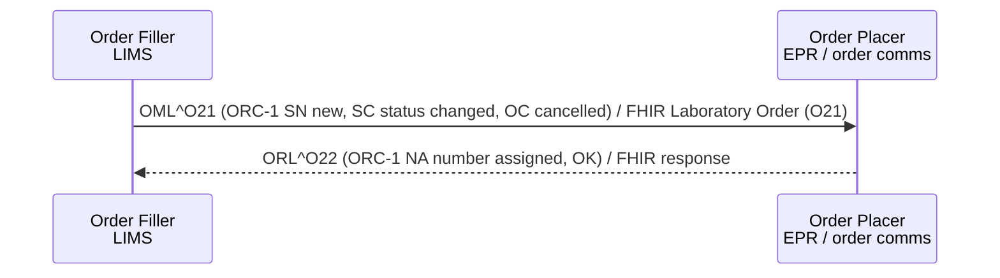

<b>Draft.</b> This implementation guide is a draft for discussion. It is <b>not</b> an
authoritative source and is not endorsed by NHS England, IHE or HL7. Check the cited
sources before using it for implementation.

**Filler Order Management [LAB-2]** - the Order Filler (LIMS) tells the Order Placer
about orders it has created or changed: a new order entered from a paper request form
(so the Order Placer can assign a Placer Order Number), a status change (specimen
received, in progress) or a cancellation by the laboratory.

### References

- [IHE PaLM TF-2](https://www.ihe.net/resources/technical_frameworks/#PaLM) - Filler Order Management [LAB-2]

### Interaction

### HL7 v2.5.1 Message

The message structure is the same as [LAB-1](LAB-1.html#hl7-v251-message---omlo21);
ORC-1 and ORC-5 carry the change:

| ORC-1 | ORC-5 | Meaning | ServiceRequest.status |
|---|---|---|---|
| SN | - | New order created by the laboratory - please assign a Placer Order Number | active |
| SC | IP | Specimen received / in process | active |
| SC | CM | Order complete (results sent in LAB-3) | completed |
| OC | CA | Order cancelled by the laboratory (for example specimen unsuitable) | revoked |
{:.grid}

The reason for a laboratory cancellation **SHOULD** be sent in ORC-16 Order Control Code
Reason (FHIR: the [Laboratory Order](StructureDefinition-LaboratoryOrder.html) `note`, or a
`statusReason` extension - **Open**).

Many NHS order comms systems do not implement LAB-2; the Order Placer learns the order
status from the results in <a href="LAB-3.html">LAB-3</a> (OBR-25). Where LAB-2 is not
used, results for paper requests arrive with a Filler Order Number only.

### FHIR Message

The same [Laboratory Order (O21)](MessageDefinition-laboratory-order.html) message as LAB-1,
sent by the Order Filler. Because the Order Filler is the sender, the
[Laboratory Order](StructureDefinition-LaboratoryOrder.html) always has a
`fillerOrderNumber` identifier.
