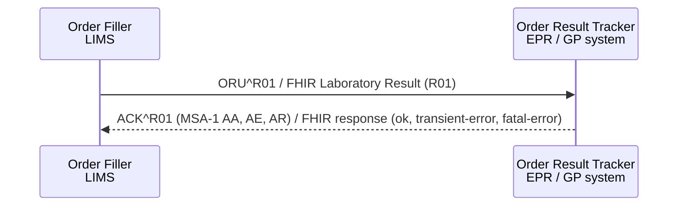

<div class="alert alert-danger" role="alert">
<b>Draft.</b> This implementation guide is a draft for discussion. It is <b>not</b> an
authoritative source and is not endorsed by NHS England, IHE or HL7. Check the cited
sources before using it for implementation.
</div>

**Order Results Management [LAB-3]** - the Order Filler (LIMS) sends results to the
Order Result Tracker (EPR, GP system, shared care record): preliminary, final and
corrected results, and cancellations.

### References

- [IHE PaLM TF-2](https://www.ihe.net/resources/technical_frameworks/#PaLM) - Order Results Management [LAB-3]
- [Digital Health and Care Wales - HL7 ORU_R01 2.5.1 Implementation Guide](https://nw-gmsa.github.io/DHCW-HL7-v2-5-1-ORUR01-Specification.pdf) - the source of most of the field rules on [HL7 v2.5.1 Segments](hl7v2.html)
- [NW GMSA - ORU_R01](https://nw-gmsa.github.io/en/hl7v2.html#oru_r01-unsolicited-transmission-of-an-observation-message)
- [HL7 v2-to-FHIR - ORU_R01 to Bundle](https://build.fhir.org/ig/HL7/v2-to-fhir/ConceptMap-message-oru-r01-to-bundle.html)

### Interaction



### HL7 v2.5.1 Message - ORU^R01

| Segment | Optionality | Notes | FHIR |
|---|---|---|---|
| [MSH](hl7v2.html#msh) | 1..1 | MSH **SHALL NOT** be used to derive patient, clinician or identifier information | [MessageHeader](StructureDefinition-MessageHeader.html) |
| **PATIENT_RESULT** | 1..* | | |
| - [PID](hl7v2.html#pid) | 1..1 | | [Patient](StructureDefinition-Patient.html) |
| - [NTE](hl7v2.html#nte) | 0..* | Patient comments (clinical history) | `Patient` - not mapped (**Open**) |
| - [PV1](hl7v2.html#pv1) | 0..1 | Requesting location (PV1-3) and clinician (PV1-8) - the place the report returns to | `DiagnosticReport.encounter`, `ServiceRequest.requester` |
| - **ORDER_OBSERVATION** | 1..* | One per test group or test. The OBRs sharing OBR-3 are one report | |
| -- [ORC](hl7v2.html#orc) | 0..1 | **SHOULD** be sent where there was an electronic order | [Laboratory Order](StructureDefinition-LaboratoryOrder.html) |
| -- [OBR](hl7v2.html#obr) | 1..1 | | [Laboratory Report](StructureDefinition-LaboratoryReport.html) (one per report) and, with several OBX, a test group [Laboratory Result](StructureDefinition-LaboratoryResult.html) |
| -- [NTE](hl7v2.html#nte) | 0..* | Report comment (NTE-2 = `L`) | `DiagnosticReport.conclusion` |
| -- [TQ1](hl7v2.html#tq1) | 0..* | Priority of the original request | `ServiceRequest.priority` |
| -- **OBSERVATION** | 1..* | | |
| --- [OBX](hl7v2.html#obx) | 1..1 | | [Laboratory Result](StructureDefinition-LaboratoryResult.html), or `DiagnosticReport.presentedForm` for `ED` / `RP` |
| --- [NTE](hl7v2.html#nte) | 0..* | Result comment | `Observation.note` |
| -- **SPECIMEN** | 0..* | | |
| --- [SPM](hl7v2.html#spm) | 1..1 | | [Specimen](StructureDefinition-Specimen.html) |
{:.grid}

#### Report Status

The overall report status is **OBR-25**. It **SHALL** be sent and **SHALL** be accurate.
Where a report has several OBRs, each carries the report status and it **SHOULD** be the same
on all of them (FHIR: the one DiagnosticReport's `status`; the test group Observation takes
its own OBR-25). OBX-11 is the status of the individual result. DHCW notes
receivers that use OBR-25 for the whole report and disregard OBX-11; senders
**SHOULD** therefore keep OBR-25 and OBX-11 consistent. See
[v2-0123-to-diagnostic-report-status](ConceptMap-v2-0123-to-diagnostic-report-status.html) and
[v2-0085-to-observation-status](ConceptMap-v2-0085-to-observation-status.html).

#### Corrections

A corrected result is sent as a new ORU with the same Filler Order Number, OBR-25 = `C`
and the corrected OBX-11 = `C`. It **replaces** the earlier result (FHIR: update the
same DiagnosticReport and Observation - same identifiers - with status `corrected`).
A result sent for the wrong patient is withdrawn with OBX-11 = `W` (FHIR:
`entered-in-error`).

### FHIR Message

The FHIR equivalent is the [Laboratory Result (R01)](MessageDefinition-laboratory-result.html)
message: a [Bundle Message](StructureDefinition-BundleMessage.html) whose
[MessageHeader](StructureDefinition-MessageHeader.html) has `eventCoding` v2-0003 `R01` and
focus the [Laboratory Report](StructureDefinition-LaboratoryReport.html)(s). More examples:
the [NHS England examples as `ORU^R01`](NHSEnglandExamples.html). `ACK^R01`
is a FHIR response message (`MessageHeader.response`). For the NHS England national
route the same content is a FHIR Document - see
[NHS England Pathology Laboratory Reporting API](PathologyReportingAPI.html).

### Example

The full blood count result for the [LAB-1 example](LAB-1.html#example).

```
MSH|^~\&|LIMS|R0A|GPSYSTEM|A12345|20261103160530||ORU^R01^ORU_R01|LIMS-MSG-000987|P|2.5.1|||AL
PID|1||633^^^R0A^MR~9449305552^^^NHS^NH||CHISLETT^Octavia^^^Miss||20080920|F|||1 RAVENSFIELD GARDENS^^EPSOM^SURREY^KT19 0ST|||||||||||||||||||||01
PV1|1|O|^^^^^^^^Example Surgery^A12345|||||G1234567^GREEN^Alex^^^Dr^^^GMP^^^^DN
ORC|RE|GP-ORD-000123^GPSYSTEM|26H012345^LIMS|GP-REQ-000045^GPSYSTEM|CM||||20261103091000|||G1234567^GREEN^Alex^^^Dr^^^GMP^^^^DN|||||||||Example Surgery^^^^^^^^^A12345
OBR|1|GP-ORD-000123^GPSYSTEM|26H012345^LIMS|1022441000000101^FBC - full blood count^SCT|||20261103091500|||||||||G1234567^GREEN^Alex^^^Dr^^^GMP^^^^DN||||||20261103160500||HM|F|||||||7654321&HUGHES&Sam&&&Dr&&&GMC
NTE|1|L|Mild anaemia with low white cell count. Suggest repeat in 4 weeks.
OBX|1|NM|1022541000000102^Total white cell count^SCT^6690-2^Leukocytes [#/volume] in Blood by Automated count^LN||3.5|10*9/L^^UCUM|4.0-11.0|L|||F|||20261103091500|||||||||Manchester University NHS Foundation Trust^^^^^^^^^R0A
OBX|2|NM|1022431000000105^Haemoglobin estimation^SCT^718-7^Hemoglobin [Mass/volume] in Blood^LN||112|g/L^^UCUM|115-165|L|||F|||20261103091500|||||||||Manchester University NHS Foundation Trust^^^^^^^^^R0A
OBX|3|NM|1022651000000100^Platelet count^SCT^777-3^Platelets [#/volume] in Blood by Automated count^LN||250|10*9/L^^UCUM|150-400|N|||F|||20261103091500|||||||||Manchester University NHS Foundation Trust^^^^^^^^^R0A
OBX|4|NM|1022451000000103^Red blood cell count^SCT^789-8^Erythrocytes [#/volume] in Blood by Automated count^LN||4.20|10*12/L^^UCUM|3.80-5.80|N|||F|||20261103091500|||||||||Manchester University NHS Foundation Trust^^^^^^^^^R0A
OBX|5|NM|1022291000000105^Haematocrit^SCT^4544-3^Hematocrit [Volume Fraction] of Blood by Automated count^LN||0.38|L/L^^UCUM|0.37-0.47|N|||F|||20261103091500|||||||||Manchester University NHS Foundation Trust^^^^^^^^^R0A
OBX|6|NM|1022491000000106^Mean cell volume^SCT^787-2^MCV [Entitic mean volume] in Red Blood Cells by Automated count^LN||88|fL^^UCUM|80-100|N|||F|||20261103091500|||||||||Manchester University NHS Foundation Trust^^^^^^^^^R0A
OBX|7|NM|1022471000000107^Mean cell haemoglobin^SCT^785-6^MCH [Entitic mass] by Automated count^LN||29.0|pg^^UCUM|27.0-33.0|N|||F|||20261103091500|||||||||Manchester University NHS Foundation Trust^^^^^^^^^R0A
SPM|1|GP-SPC-000123&GPSYSTEM^26H012345&LIMS||119297000^Blood specimen^SCT|||||||||||||20261103091500|20261103134000
```

and its acknowledgement:

```
MSH|^~\&|GPSYSTEM|A12345|LIMS|R0A|20261103160532||ACK^R01^ACK|GP-MSG-000777|P|2.5.1
MSA|AA|LIMS-MSG-000987
```

FHIR equivalents: [Bundle Message - Laboratory Result (R01)](Bundle-LaboratoryResultMessage.html)
and [Bundle Message - Acknowledgement](Bundle-LaboratoryResultAcknowledgement.html). The
segment by segment conversion is worked through on [Mapping HL7 v2 and FHIR](mapping.html#worked-example).
