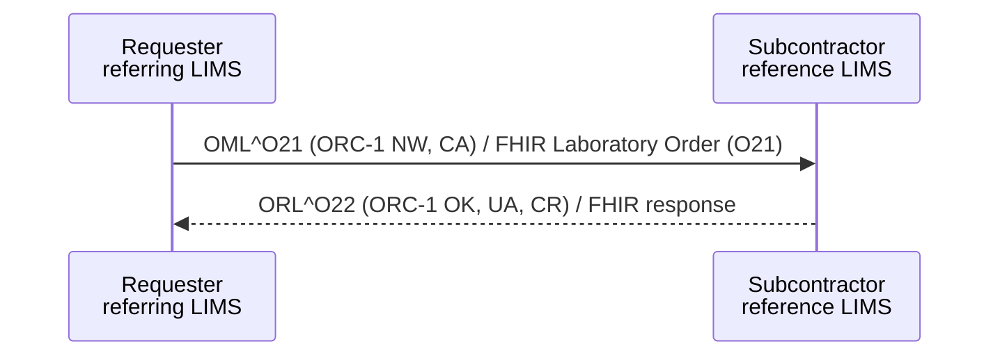

<b>Draft.</b> This implementation guide is a draft for discussion. It is <b>not</b> an
authoritative source and is not endorsed by NHS England, IHE or HL7. Check the cited
sources before using it for implementation.

**Sub-order Management [LAB-35]** - the Requester (the referring laboratory's LIMS)
sends a sub-order to the Subcontractor (the performing laboratory's LIMS) and may
cancel it. See [Inter-Laboratory Workflow (ILW)](ILW.html).

### References

- [IHE PaLM TF-2](https://www.ihe.net/resources/technical_frameworks/#PaLM) - Sub-order Management [LAB-35]
- [NW GMSA - Inter Laboratory Workflow (ILW)](https://nw-gmsa.github.io/en/ILW.html) - distributed WGS sub-orders use the same transaction

<b>In England</b> laboratory to laboratory requests and results often go through
<b>NPEx</b>, the National Pathology Exchange - now marketed as <b>Labgnostic</b>, provided by
X-Lab Ltd and hosted with The Health Informatics Service (THIS) as a national NHS service since
2010. Each LIMS connects once to the exchange (rather than to every other laboratory), and
the exchange carries the sub-order ([LAB-35](LAB-35.html)) and its results
([LAB-36](LAB-36.html)). The identifiers, codes and content rules on these pages still apply
to what each LIMS sends to and receives from the exchange. Message formats and onboarding are
agreed with the provider (<b>To confirm</b> which HL7 v2 messages and versions NPEx uses).

### Interaction

### HL7 v2.5.1 Message

`OML^O21`, with the same structure as [LAB-1](LAB-1.html#hl7-v251-message---omlo21). The
differences are in who fills which field:

| Field | LAB-35 content | FHIR |
|---|---|---|
| MSH-4 / MSH-6 | Requester / Subcontractor laboratory ODS codes | `MessageHeader.sender` / `destination.receiver` |
| ORC-2 / OBR-2 | Sub-order number assigned by the Requester | `ServiceRequest.identifier` (`PLAC`) |
| ORC-8 / OBR-29 Parent | The original order: Placer Order Number^Filler Order Number at the Requester | `ServiceRequest.basedOn` |
| ORC-12 / OBR-16 | The original requesting clinician (not the referring laboratory) | `ServiceRequest.requester` |
| ORC-21 | The Requester laboratory | `ServiceRequest.requester` (Organization) - **Open**: requester or performer? |
| SPM-2 | The specimen (or aliquot) identifier the Requester labelled it with | `Specimen.identifier` |
| SPM-3 | The Requester's parent specimen, if this is an aliquot | `Specimen.parent` |
{:.grid}

### FHIR Message

The same [Laboratory Order (O21)](MessageDefinition-laboratory-order.html) message as LAB-1.
