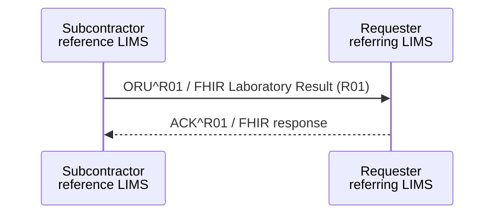

<b>Draft.</b> This implementation guide is a draft for discussion. It is <b>not</b> an
authoritative source and is not endorsed by NHS England, IHE or HL7. Check the cited
sources before using it for implementation.

**Sub-order Results Delivery [LAB-36]** - the Subcontractor returns the results of a
sub-order to the Requester, which then includes them in its own results to the Order
Result Tracker ([LAB-3](LAB-3.html)). See [Inter-Laboratory Workflow (ILW)](ILW.html).

### References

- [IHE PaLM TF-2](https://www.ihe.net/resources/technical_frameworks/#PaLM) - Sub-order Results Delivery [LAB-36]

### Interaction

### HL7 v2.5.1 Message

`ORU^R01`, with the same structure as [LAB-3](LAB-3.html#hl7-v251-message---orur01). In
addition:

- OBR-2 is the Requester's sub-order number and OBR-3 the Subcontractor's laboratory
  number
- OBR-29 Parent **SHOULD** repeat the original order (from LAB-35 ORC-8)
- OBX-23 / OBX-24 / OBX-25 **SHALL** identify the Subcontractor as the performing
  laboratory, and **SHALL** be kept by the Requester when it reports the result onward
  in LAB-3 (FHIR: `Observation.performer` stays the Subcontractor; the Requester is the
  `DiagnosticReport.performer` of its own report)

### FHIR Message

The same [Laboratory Result (R01)](MessageDefinition-laboratory-result.html) message as LAB-3.
