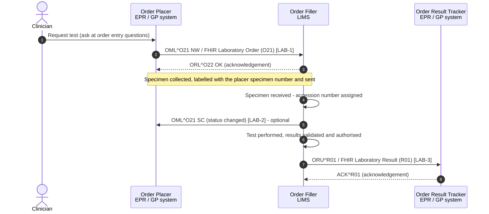

<b>Draft.</b> This implementation guide is a draft for discussion. It is <b>not</b> an
authoritative source and is not endorsed by NHS England, IHE or HL7. Check the cited
sources before using it for implementation.

The IHE PaLM **Laboratory Testing Workflow (LTW)** profile covers the ordering and
resulting of in vitro diagnostic tests: a clinician orders a test, a specimen is
collected and sent to the laboratory, the laboratory performs the test and the
results are returned to the requester and stored in the patient record.

### References

- [IHE PaLM TF-1](https://www.ihe.net/resources/technical_frameworks/#PaLM) - Laboratory Testing Workflow (LTW)
- [IHE PaLM TF-2](https://www.ihe.net/resources/technical_frameworks/#PaLM) - transactions LAB-1, LAB-2, LAB-3
- [NW GMSA - Laboratory Testing Workflow (LTW)](https://nw-gmsa.github.io/en/LTW.html) - the genomics equivalent of this page

### Process Flow

### Ordering Patterns in England

| Pattern | Order Placer | Order Filler | Order Result Tracker | Notes |
|---|---|---|---|---|
| Electronic order, same trust | Trust EPR / order comms | Trust LIMS | Trust EPR | All of LTW. Placer Order Number from the EPR |
| Electronic order from primary care | GP order comms | Trust or network LIMS | GP clinical system | Results to the GP are delivered by results distribution middleware - see [Results Distribution in England](ResultsDistribution.html) |
| Paper request form | (none) | LIMS (order entered on receipt) | EPR / GP system | No LAB-1. The LIMS creates the order; LAB-2 *may* notify the Order Placer. LAB-3 results have a Filler Order Number but no Placer Order Number |
| Order to another laboratory | Requesting LIMS | Subcontractor LIMS | Requesting LIMS | See [Inter-Laboratory Workflow](ILW.html) |
{:.grid}

### Identifiers

The workflow depends on identifiers being kept and echoed back:

| Identifier | Assigned by | HL7 v2 | FHIR |
|---|---|---|---|
| Placer Order Number | Order Placer | ORC-2 / OBR-2 | `ServiceRequest.identifier` (type `PLAC`), `DiagnosticReport.basedOn` |
| Placer Group Number (all tests on one request form) | Order Placer | ORC-4 | `ServiceRequest.requisition` |
| Filler Order Number (laboratory number) | Order Filler | ORC-3 / OBR-3 | `ServiceRequest.identifier` (type `FILL`), `DiagnosticReport.identifier` |
| Placer specimen number (label) | Order Placer | SPM-2.1 | `Specimen.identifier` (type `PLAC`) |
| Accession number | Order Filler | SPM-2.2 | `Specimen.accessionIdentifier` |
| NHS Number | NHS (PDS) | PID-3 (`NHS^NH`) | `Patient.identifier` |
| Hospital number (MRN) | Trust PAS | PID-3 (`<ODS>^MR`) | `Patient.identifier` |
{:.grid}

### Order Status

The Order Placer needs to know what has happened to an order. In HL7 v2 this is ORC-1
(order control) and ORC-5 (order status) in LAB-2, and OBR-25 (result status) in
LAB-3. In FHIR, `ServiceRequest.status` and `DiagnosticReport.status` - see the
[ConceptMaps](terminology.html#hl7-v2-tables).

| Stage | ORC-1 / ORC-5 | OBR-25 | ServiceRequest.status | DiagnosticReport.status |
|---|---|---|---|---|
| Order placed | NW / - | - | active | - |
| Order accepted | OK / IP | - | active | - |
| Specimen received | SC / IP | I | active | registered |
| Partial results | RE / A | P or A | active | preliminary or partial |
| Final results | RE / CM | F | completed | final |
| Corrected results | RE / CM | C | completed | corrected |
| Order cancelled | CA, OC / CA | X | revoked | cancelled |
{:.grid}
