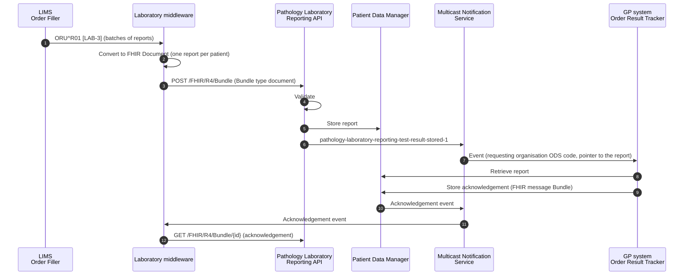

<b>Draft.</b> This implementation guide is a draft for discussion. It is <b>not</b> an
authoritative source and is not endorsed by NHS England, IHE or HL7. Check the cited
sources before using it for implementation.

The **NHS England Pathology and Laboratory Medicine Reporting FHIR API** lets laboratory
middleware send structured pathology test reports to the general practice that
requested the test, and retrieve the practice's acknowledgement. It replaces
[Pathology Messaging - EDIFACT](https://digital.nhs.uk/developer/api-catalogue/pathology-messaging-edifact)
and implements the DAPB4101 Pathology and Laboratory Medicine Reporting information
standard. In IHE terms it is a national route for
[Order Results Management [LAB-3]](LAB-3.html), with the report sent as a document
(as in IHE XD-LAB) rather than a message.

The API and the event were <b>in development</b> when this page was written (November
2026); the event page says it will be in production in 2027. Onboarding is by
invitation. Check the NHS England pages for the current status.

### References

- [Pathology and Laboratory Medicine Reporting - FHIR API](https://digital.nhs.uk/developer/api-catalogue/pathology-laboratory-reporting) (and its OAS file)
- [Pathology and Laboratory Medicine Reporting: Test Result Stored Event](https://digital.nhs.uk/developer/api-catalogue/multicast-notification-service/pathology-test-result-stored-event)
- [NHS England Pathology FHIR Implementation Guide](https://simplifier.net/guide/pathology-fhir-implementation-guide) (Simplifier)
- [DAPB4101 Pathology and Laboratory Medicine Reporting information standard](https://digital.nhs.uk/data-and-information/information-standards/governance/latest-activity/standards-and-collections/dapb4101-pathology-and-laboratory-medicine-reporting-information-standard)
- [Patient Data Manager](https://digital.nhs.uk/developer/api-catalogue/patient-data-manager) and the [Multicast Notification Service](https://digital.nhs.uk/developer/api-catalogue/multicast-notification-service)

### Specialisms

The API covers clinical biochemistry (chemical pathology), haematology, immunology,
transfusion medicine and microbiology (bacteriology, virology and serology), with
further specialisms under review.

### Process Flow

### Send a Laboratory Test Report

`POST /FHIR/R4/Bundle`. The request Bundle **SHALL**:

| Rule (from the API specification) | This guide |
|---|---|
| have `type` = `document` | [Bundle - Laboratory Report Document](StructureDefinition-BundleLaboratoryReportDocument.html) |
| have a `Composition` as the first entry | [Laboratory Report Composition](StructureDefinition-LaboratoryReportComposition.html) |
| contain exactly one `DiagnosticReport` | [Laboratory Report](StructureDefinition-LaboratoryReport.html) - one report per Bundle. A multi-OBR ORU becomes several Bundles |
| identify the calling application in `Provenance.agent.who.identifier.value` as `<Product ID>:<(Optional) Test Reporter identifier>` | [Laboratory Report Provenance](StructureDefinition-LaboratoryReportProvenance.html) |
| give the ODS code of the requesting organisation, through `DiagnosticReport.basedOn` → `ServiceRequest.requester` → `Organization.identifier` (or → `PractitionerRole.organization` → `Organization.identifier`); only one requesting ODS code per report | [Laboratory Order](StructureDefinition-LaboratoryOrder.html) `requester`, [PractitionerRole](StructureDefinition-PractitionerRole.html) |
| give the patient's NHS Number in `Composition.subject.identifier.value` | [Laboratory Report Composition](StructureDefinition-LaboratoryReportComposition.html) `subject.identifier` |
| follow the NHS England Pathology FHIR IG, including a permitted `meta.profile` on every resource | see the table below |
{:.grid}

#### Profiles

The API names these profiles (versions from its OAS file). This guide's profiles are
derived from the same HL7 Europe base where it can be, so content that conforms to this
guide is close to the NHS England form; the differences are listed.

| Resource | NHS England (`meta.profile`) | This guide | Difference |
|---|---|---|---|
| Bundle | `https://fhir.nhs.uk/England/StructureDefinition/England-Bundle-Lab-Pathology` 0.1.0 | [Bundle - Laboratory Report Document](StructureDefinition-BundleLaboratoryReportDocument.html) | Both from HL7 Europe `Bundle-eu-lab` (**To confirm** for England) |
| Composition | `http://hl7.eu/fhir/laboratory/StructureDefinition/Composition-eu-lab` 2.0.0 | [Laboratory Report Composition](StructureDefinition-LaboratoryReportComposition.html) | This guide uses EU Laboratory 2.1.0 |
| DiagnosticReport | `http://hl7.eu/fhir/laboratory/StructureDefinition/DiagnosticReport-eu-lab` 2.0.0-nhs-fix | [Laboratory Report](StructureDefinition-LaboratoryReport.html) + DiagnosticReport-eu-lab | NHS England uses a locally amended EU Lab profile; what was amended is **To confirm**. This guide's report is derived from EU Core so it can also be used in FHIR Messages - see [FHIR Resources](DataModel.html) |
| Observation | `https://fhir.nhs.uk/England/StructureDefinition/England-Observation-Lab-Pathology` 0.3.0 | [Laboratory Result](StructureDefinition-LaboratoryResult.html) | Both from EU Laboratory `Observation-resultslab-eu-lab` (**To confirm** for England) |
| ServiceRequest | `http://hl7.eu/fhir/laboratory/StructureDefinition/ServiceRequest-eu-lab` 2.0.0 | [Laboratory Order](StructureDefinition-LaboratoryOrder.html) | |
| Patient | `http://hl7.eu/fhir/base/StructureDefinition/patient-eu-core` 2.0.0 | [Patient](StructureDefinition-Patient.html) | |
| Practitioner, PractitionerRole, Organization | UK Core (`UKCore-Practitioner` 2.4.0, `UKCore-PractitionerRole` 2.4.0, `UKCore-Organization` 2.5.0) | [Practitioner](StructureDefinition-Practitioner.html), [PractitionerRole](StructureDefinition-PractitionerRole.html), [Organization](StructureDefinition-Organization.html) | This guide uses HL7 Europe Core (which EU Laboratory references) and no UK Core dependency. The identifiers (ODS, GMC, GMP) are the same |
| Provenance | `https://fhir.nhs.uk/England/StructureDefinition/England-Provenance-Lab-Pathology` 0.1.0 | [Laboratory Report Provenance](StructureDefinition-LaboratoryReportProvenance.html) | |
{:.grid}

Example: [Bundle Document - Full blood count](Bundle-LaboratoryReportDocumentFBC.html).

When sending to the API, set <code>meta.profile</code> on each resource to the NHS England
value in the table above. The examples in this guide declare this guide's profiles.

### Retrieve a Test Report Acknowledgement

`GET /FHIR/R4/Bundle/{id}` returns the acknowledgement stored by the GP system: a
Bundle of `type` `message`, whose MessageHeader event is
`https://fhir.nhs.uk/CodeSystem/message-event#pathology-laboratory-reporting-test-result-stored-1-ack-1`
(**To confirm** - the code is taken from the OAS file). This is the national
equivalent of `ACK^R01`.

### Test Result Stored Event

When a report is stored, the API publishes an event through MNS. The event is a
notification only - the subscriber retrieves the report from PDM.

| CloudEvents field | Value |
|---|---|
| `specversion` | `1.0` |
| `id` | GUID for the event |
| `source` | `uk.nhs.pathology-laboratory-reporting` (in the FHIR example) |
| `type` | `pathology-laboratory-reporting-test-result-stored-1` |
| `time` | ISO 8601 event time |
| `versionid` | version of the event |
{:.grid}

The FHIR form of the event is a `history` Bundle containing a FHIR Subscriptions
`Parameters` notification (`type` = `event-notification`) whose `focus` points to the
report Bundle in PDM and whose `additional-context` carries the event type, source and
subject (the patient's NHS Number).

GP systems subscribe with filters on `requestingOrganisationODS` (the ODS code of the
requesting organisation) - the value this guide carries in
`ServiceRequest.requester` - and **SHOULD NOT** subscribe more widely than their own
practices.

### Converting an ORU^R01 for the API

The laboratory middleware receives `ORU^R01` from the LIMS and sends FHIR Documents to
the API. Use the [HL7 v2 to FHIR mapping](mapping.html) to build the resources, then
[package them as a document](mapping.html#fhir-message-to-fhir-document):

- one Bundle per **OBR** (exactly one DiagnosticReport per Bundle), each with its own
  Composition
- reject (do not send) a report with no NHS Number in PID-3 or no requesting
  organisation ODS code (PV1-3, ORC-21 or the ordering provider's organisation) -
  the API will reject it
- reports of paper requests (no ORC-2 / OBR-2) still need a ServiceRequest for the
  requester; build it from ORC-12 / OBR-16 and PV1-3 / ORC-21 (**To confirm** with NHS
  England)
