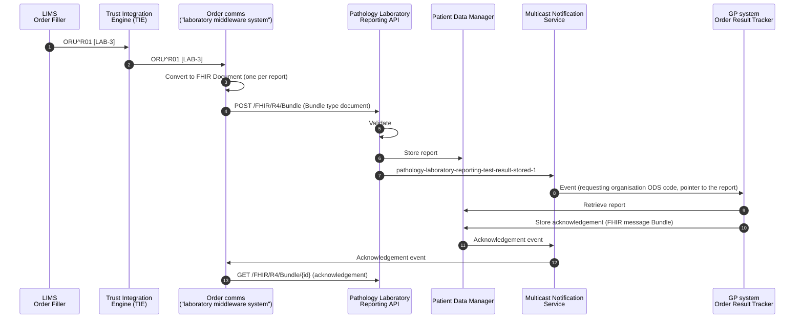

<b>Draft.</b> This implementation guide is a draft for discussion. It is <b>not</b> an
authoritative source and is not endorsed by NHS England, IHE or HL7. Check the cited
sources before using it for implementation.

The **NHS England Pathology and Laboratory Medicine Reporting FHIR API** lets a
*laboratory middleware system* send structured pathology test reports to the general
practice that requested the test, and retrieve the practice's acknowledgement. It replaces
[Pathology Messaging - EDIFACT](https://digital.nhs.uk/developer/api-catalogue/pathology-messaging-edifact)
and implements the DAPB4101 Pathology and Laboratory Medicine Reporting information
standard. In IHE terms it is a national route for
[Order Results Management [LAB-3]](LAB-3.html), with the report sent as a document
(as in IHE XD-LAB) rather than a message.

<b>Recommendation.</b> DAPB4101 is written for reporting to general practice, but its
content - the SNOMED CT PaLM codes, units and report structure - <b>SHOULD</b> be applied to
all laboratory reporting in England: LIMS to trust EPR, laboratory to laboratory
(<a href="ILW.html">ILW</a>) and to shared care records, in HL7 v2 as well as FHIR. One
content standard everywhere means a result can move between routes without being recoded,
and the national conversion described below becomes a change of container, not of content.

### Who is the "Laboratory Middleware System"?

The NHS England diagrams show a *Laboratory Middleware System* between the laboratory and
the API. In practice this is likely to be the **GP order communications (order comms)
system** - the Order Placer the GP used to request the test, which already receives the
results to return them to the practice. Do not confuse it with the middleware used
*inside* laboratories and trusts, which in many NHS trusts is the **Trust Integration
Engine (TIE)**.

The usual path is therefore: LIMS → TIE → order comms as HL7 v2 `ORU^R01`
([LAB-3](LAB-3.html)), then order comms → NHS England API as a FHIR Document. The
conversion from `ORU^R01` to the FHIR Document happens in the order comms system (or in the
TIE on its behalf).

The API and the event were <b>in development</b> when this page was written (November
2026); the event page says it will be in production in 2027. Onboarding is by
invitation. Check the NHS England pages for the current status.

### References

- [Pathology and Laboratory Medicine Reporting - FHIR API](https://digital.nhs.uk/developer/api-catalogue/pathology-laboratory-reporting) (and its OAS file)
- [Pathology and Laboratory Medicine Reporting: Test Result Stored Event](https://digital.nhs.uk/developer/api-catalogue/multicast-notification-service/pathology-test-result-stored-event)
- [NHS England Pathology FHIR Implementation Guide](https://simplifier.net/guide/pathology-fhir-implementation-guide) (Simplifier)
- [DAPB4101 Pathology and Laboratory Medicine Reporting information standard](https://digital.nhs.uk/data-and-information/information-standards/governance/latest-activity/standards-and-collections/dapb4101-pathology-and-laboratory-medicine-reporting-information-standard)
- [Patient Data Manager](https://digital.nhs.uk/developer/api-catalogue/patient-data-manager) and the [Multicast Notification Service](https://digital.nhs.uk/developer/api-catalogue/multicast-notification-service)

### Specialisms

The API covers clinical biochemistry (chemical pathology), haematology, immunology,
transfusion medicine and microbiology (bacteriology, virology and serology), with
further specialisms under review.

### Process Flow

### Send a Laboratory Test Report

`POST /FHIR/R4/Bundle`. The request Bundle **SHALL**:

| Rule (from the API specification) | This guide |
|---|---|
| have `type` = `document` | [Bundle - Laboratory Report Document](StructureDefinition-BundleLaboratoryReportDocument.html) |
| have a `Composition` as the first entry | [Laboratory Report Composition](StructureDefinition-LaboratoryReportComposition.html) |
| contain exactly one `DiagnosticReport` | [Laboratory Report](StructureDefinition-LaboratoryReport.html) - one report per Bundle. The OBRs of one report (sharing OBR-3) are test groups inside the one DiagnosticReport; an ORU carrying several reports becomes several Bundles |
| identify the calling application in `Provenance.agent.who.identifier.value` as `<Product ID>:<(Optional) Test Reporter identifier>` | [Laboratory Report Provenance](StructureDefinition-LaboratoryReportProvenance.html) |
| give the ODS code of the requesting organisation, through `DiagnosticReport.basedOn` → `ServiceRequest.requester` → `Organization.identifier` (or → `PractitionerRole.organization` → `Organization.identifier`); only one requesting ODS code per report | [Laboratory Order](StructureDefinition-LaboratoryOrder.html) `requester`, [PractitionerRole](StructureDefinition-PractitionerRole.html) |
| give the patient's NHS Number in `Composition.subject.identifier.value` | [Laboratory Report Composition](StructureDefinition-LaboratoryReportComposition.html) `subject.identifier` |
| follow the NHS England Pathology FHIR IG, including a permitted `meta.profile` on every resource | see the table below |
{:.grid}

#### Profiles

The API names these profiles (versions from its OAS file). This guide's profiles are
derived from the same HL7 Europe base where it can be, so content that conforms to this
guide is close to the NHS England form; the differences are listed.

| Resource | NHS England (`meta.profile`) | This guide | Difference |
|---|---|---|---|
| Bundle | `https://fhir.nhs.uk/England/StructureDefinition/England-Bundle-Lab-Pathology` 0.1.0 | [Bundle - Laboratory Report Document](StructureDefinition-BundleLaboratoryReportDocument.html) | Both from HL7 Europe `Bundle-eu-lab`. **Open**: in the published package (`fhir.r4.nhsengland.pathology` 0.3.0) this profile's `provenanceTestReportingSystem` slice is typed `Resource`, so every entry matches it and the FHIR validator reports "Element matches more than one slice" for any document declaring it. The NHS England examples declare `Bundle-eu-lab|2.0.0` instead |
| Composition | `http://hl7.eu/fhir/laboratory/StructureDefinition/Composition-eu-lab` 2.0.0 | [Laboratory Report Composition](StructureDefinition-LaboratoryReportComposition.html) | This guide uses EU Laboratory 2.1.0 |
| DiagnosticReport | `http://hl7.eu/fhir/laboratory/StructureDefinition/DiagnosticReport-eu-lab` 2.0.0-nhs-fix | [Laboratory Report](StructureDefinition-LaboratoryReport.html) + DiagnosticReport-eu-lab | NHS England uses a locally amended EU Lab profile; what was amended is **To confirm**. This guide's report is derived from EU Core so it can also be used in FHIR Messages - see [FHIR Resources](DataModel.html) |
| Observation | `https://fhir.nhs.uk/England/StructureDefinition/England-Observation-Lab-Pathology` 0.3.0 (the published package `fhir.r4.nhsengland.pathology` 0.3.0 contains version 0.2.1) | [Laboratory Result](StructureDefinition-LaboratoryResult.html) | Both from EU Laboratory `Observation-resultslab-eu-lab`. NHS England adds the R6 `Observation.organizer` extension to mark test groups |
| ServiceRequest | `http://hl7.eu/fhir/laboratory/StructureDefinition/ServiceRequest-eu-lab` 2.0.0 | [Laboratory Order](StructureDefinition-LaboratoryOrder.html) | |
| Patient | `http://hl7.eu/fhir/base/StructureDefinition/patient-eu-core` 2.0.0 | [Patient](StructureDefinition-Patient.html) | |
| Practitioner, PractitionerRole, Organization | UK Core (`UKCore-Practitioner` 2.4.0, `UKCore-PractitionerRole` 2.4.0, `UKCore-Organization` 2.5.0) | [Practitioner](StructureDefinition-Practitioner.html), [PractitionerRole](StructureDefinition-PractitionerRole.html), [Organization](StructureDefinition-Organization.html) | This guide uses HL7 Europe Core (which EU Laboratory references) and no UK Core dependency. The identifiers (ODS, GMC, GMP) are the same |
| Provenance | `https://fhir.nhs.uk/England/StructureDefinition/England-Provenance-Lab-Pathology` 0.1.0 | [Laboratory Report Provenance](StructureDefinition-LaboratoryReportProvenance.html) | |
{:.grid}

Examples: [Bundle Document - Full blood count](Bundle-LaboratoryReportDocumentFBC.html), and
the [NHS England examples](NHSEnglandExamples.html) converted from `ORU^R01` by the
[notebooks](https://github.com/KevinMayfield/PathologyAndLaboratory/tree/main/notebooks)
(`examples/fhir/document/`).

When sending to the API, set <code>meta.profile</code> on each resource to the NHS England
value in the table above. The examples in this guide declare this guide's profiles.

### Retrieve a Test Report Acknowledgement

`GET /FHIR/R4/Bundle/{id}` returns the acknowledgement stored by the GP system: a
Bundle of `type` `message`, whose MessageHeader event is
`https://fhir.nhs.uk/CodeSystem/message-event#pathology-laboratory-reporting-test-result-stored-1-ack-1`
(**To confirm** - the code is taken from the OAS file). This is the national
equivalent of `ACK^R01`.

### Test Result Stored Event

When a report is stored, the API publishes an event through MNS. The event is a
notification only - the subscriber retrieves the report from PDM.

| CloudEvents field | Value |
|---|---|
| `specversion` | `1.0` |
| `id` | GUID for the event |
| `source` | `uk.nhs.pathology-laboratory-reporting` (in the FHIR example) |
| `type` | `pathology-laboratory-reporting-test-result-stored-1` |
| `time` | ISO 8601 event time |
| `versionid` | version of the event |
{:.grid}

The FHIR form of the event is a `history` Bundle containing a FHIR Subscriptions
`Parameters` notification (`type` = `event-notification`) whose `focus` points to the
report Bundle in PDM and whose `additional-context` carries the event type, source and
subject (the patient's NHS Number).

GP systems subscribe with filters on `requestingOrganisationODS` (the ODS code of the
requesting organisation) - the value this guide carries in
`ServiceRequest.requester` - and **SHOULD NOT** subscribe more widely than their own
practices.

### Converting an ORU^R01 for the API

The order comms system (the "laboratory middleware system") receives `ORU^R01` from the
LIMS, usually through the TIE, and sends FHIR Documents to the API. Use the
[HL7 v2 to FHIR mapping](mapping.html) to build the resources, then
[package them as a document](mapping.html#fhir-message-to-fhir-document). Worked examples:
notebooks
[01-oru-r01-to-fhir-message](https://github.com/KevinMayfield/PathologyAndLaboratory/blob/main/notebooks/01-oru-r01-to-fhir-message.ipynb)
and
[02-fhir-message-to-fhir-document](https://github.com/KevinMayfield/PathologyAndLaboratory/blob/main/notebooks/02-fhir-message-to-fhir-document.ipynb).

- one Bundle per **report** (the OBRs sharing OBR-3 - exactly one DiagnosticReport per
  Bundle), each with its own Composition; each OBR is a ServiceRequest and a test group
  Observation (an *organizer*, `hasMember` its OBX) - or, with a single OBX, just that result
- reject (do not send) a report with no NHS Number in PID-3 or no requesting
  organisation ODS code (PV1-3, ORC-21 or the ordering provider's organisation) -
  the API will reject it
- reports of paper requests (no ORC-2 / OBR-2) still need a ServiceRequest for the
  requester; build it from ORC-12 / OBR-16 and PV1-3 / ORC-21 (**To confirm** with NHS
  England)
- the identifier systems (FHIR `Identifier.system`) are not in the `ORU^R01` - the LIMS sends
  `value^namespace`. The converter assigns them from an agreed table of field and namespace
  to system
- the `ORU^R01` carries only codes for practitioners and organisations (GMC / GMP, ODS), so the
  document's Practitioner and Organization resources (requester, laboratory) are looked up -
  from the [ODS APIs](https://digital.nhs.uk/services/organisation-data-service/organisation-data-service-apis)
  or [ODS CSV downloads](https://digital.nhs.uk/services/organisation-data-service/data-search-and-export/csv-downloads)
  (`epraccur.csv`, `egpcur.csv`), usually through a local cache

### Human Readable and Computer Processable

A FHIR Document carries the report twice, in two forms that **SHALL** agree:

- **computer processable** - the resources and their coded elements: `Observation.code`,
  `valueQuantity`, `referenceRange`, `interpretation`, the ServiceRequest and Specimen. This is
  what the GP system files, graphs and uses for decision support
- **human readable** - the *narrative*: XHTML in `Composition.text` (the document header) and
  in each `Composition.section.text` (that part of the report). This is what a clinician sees
  when the document is displayed, printed or forwarded, and it is the attested content of
  the document. A receiver that does not understand a coded element can still show the
  report safely

The NHS England examples leave the section narrative `empty`. A system creating the document
from an `ORU^R01` has everything it needs to generate it, and **SHOULD** do so.

#### What it means when transforming ORU^R01

- **Build the resources first, then generate the narrative from them** - not from the HL7 v2
  text. The narrative then cannot disagree with the data (a value rounded differently, a lost
  flag or comment is a clinical safety issue). Set `text.status` = `generated`
- **One section per test group**: each OBR becomes a section whose `code` is the test group
  code (OBR-4), whose `entry` is the test group Observation, and whose narrative is a table
  of its OBX
- **`Composition.text`** holds what identifies the report: NHS Number (PID-3), report number
  (OBR-3), status (OBR-25), requester (ORC-12 / ORC-21), laboratory (OBX-23 / MSH-4),
  specimen and collection time (SPM-4, SPM-17), and when the report was issued (OBR-22)

#### Tips for the XHTML

- The root is `
`. Use the FHIR narrative subset:
  `p`, `br`, `b`, `i`, `span`, `table`, `tr`, `th`, `td`, `ul`, `li`, `pre`. No `script`,
  `style` elements, forms, event attributes, or external images or links to resources
  outside the document
- **Escape all text** taken from the message - `<`, `>` and `&` occur in results (`<5`,
  `>35 x10*6/L`) and in comments, and will otherwise break the XHTML or inject markup. Undo
  the HL7 v2 escapes (`\F\`, `\S\`, `\T\`, `\R\`, `\E\`) first
- **Lay results out as the laboratory reports them**: Test, Result, Units, Reference range,
  Flag; result comments (NTE after the OBX) under the table; report comments (NTE after the
  OBR) in their own section
- **Keep the layout of text results**: `\.br\` in an `FT` / `TX` OBX becomes a new line in
  `valueString`; show it with ` ` (or `<pre>` for column-aligned microbiology and dynamic
  function test reports), otherwise the lines run together
- **Show flags in words** ("Low", "High", "Critically high") as well as emphasis - never rely
  on colour alone
- **Keep it a summary** of the coded content: do not paste the whole HL7 v2 message, and do
  not add anything that is not in the resources

The [notebook](https://github.com/KevinMayfield/PathologyAndLaboratory/blob/main/notebooks/02-fhir-message-to-fhir-document.ipynb)
generates the narrative this way for the NHS England examples.
