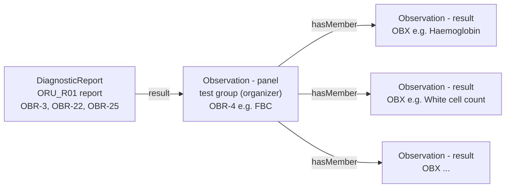
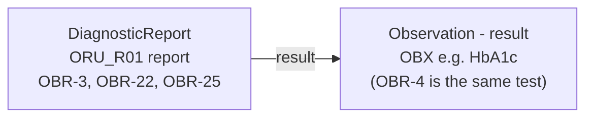
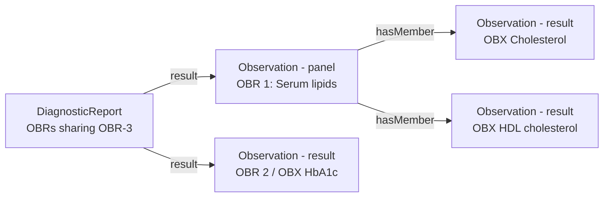
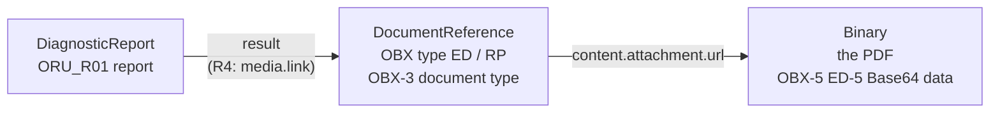
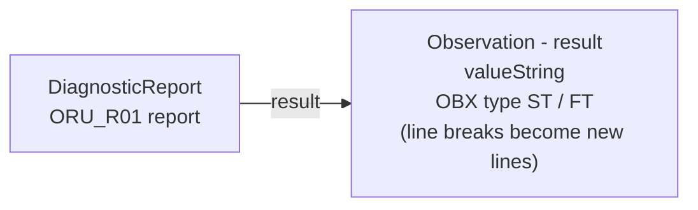
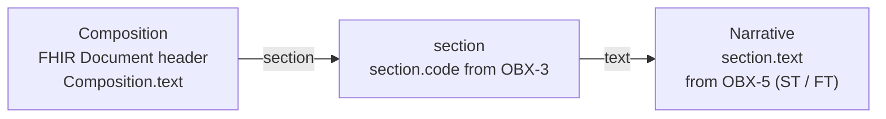
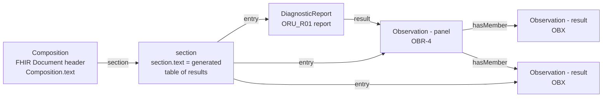

<b>Draft.</b> This implementation guide is a draft for discussion. It is <b>not</b> an
authoritative source and is not endorsed by NHS England, IHE or HL7. Check the cited
sources before using it for implementation.

Pathology reports come in two broad kinds. Which kind a report is decides how easily it fits
a FHIR Document. A FHIR Document requires a `Composition` with human-readable narrative,
so the kind that fits worst is the discrete result (FBC, HbA1c, U&E) - the opposite of what
is often assumed.

### Terms

| Term used in this guide | Also called | Meaning |
|---|---|---|
| **Narrative (interpretive) report** | unstructured / semi-structured report, opinion-based or consultative report, document-based report | The result *is* the opinion of a pathologist or clinical scientist, written as text - often under headings, sometimes as a PDF |
| **Discrete (numeric) result** | structured / coded result, analytical result, observation-based result, atomic data | The result is a set of values produced by an analyser - a code, a value, units, a reference range and a flag for each test |
| **Synoptic report** | structured report, dataset report | A narrative report whose key items are recorded as discrete data from a defined dataset (for example the RCPath cancer datasets) |
{:.grid}

Where a single word is wanted on each side, this guide uses **report** for the narrative kind
and **result** for the discrete kind. The NHS and RCPath split between **cellular pathology**
and **blood sciences** follows the same line roughly, but not exactly: microbiology,
genomics and interpretive comments in blood sciences fall on either side.

In messaging the difference shows as:

| | Narrative report | Discrete result |
|---|---|---|
| HL7 v2 | `OBX` of type `FT` / `TX` (often many lines with `\.br\`), `NTE`, or `ED` (an embedded PDF) | `OBX` of type `NM`, `CWE` / `CE`, `SN`, with `OBX-6` units, `OBX-7` range, `OBX-8` flag |
| FHIR | `DiagnosticReport.conclusion` / `presentedForm`, `Observation.valueString`, `Composition.section.text` | `Observation.valueQuantity` / `valueCodeableConcept`, `referenceRange`, `interpretation` |
{:.grid}

### Which Reports Are Usually Narrative

Usually narrative (text with headings, or PDF):

- **Histopathology / surgical pathology** - clinical details, macroscopic, microscopic,
  conclusion. Cancer resections follow the RCPath datasets (synoptic), but are often still sent
  as text with a table inside it
- **Cytopathology** - non-gynae cytology (fluids, FNA); cervical screening is more coded but
  carries text
- **Post-mortem reports**
- **Haematology interpretation** - blood film comments, bone marrow aspirate and trephine,
  flow cytometry immunophenotyping
- **Genomic and molecular pathology** - often PDF (Genomic Laboratory Hub reports, NGS panels,
  whole genome sequencing, variant interpretation)
- **Cytogenetics** - karyotype (ISCN string) and FISH, with interpretation
- **Specialist and referral tests** - results from reference laboratories, often PDFs
  attached by the local LIMS rather than re-keyed
- **Microbiology** - in part: organism and sensitivities can be discrete, but culture
  narratives, clinical advice, TB and mycology reports are text
- **Interpretive comments** on discrete results - dynamic function tests, protein
  electrophoresis / paraprotein, thrombophilia screens

Usually discrete:

- routine clinical biochemistry (U&E, LFT, lipids, HbA1c)
- routine haematology (FBC, coagulation)
- most immunoassays and serology with numeric or qualitative results

Cellular pathology is out of scope of this guide - see
[Cancer Pathology Report](https://kevinmayfield.github.io/CancerPathologyReport/); genomics is
covered by the [NW GMSA FHIR IG](https://nw-gmsa.github.io/en/). They are listed here because
the distinction matters for the specialisms that are in scope (see
[Specialisms](PathologyReportingAPI.html#specialisms)), which are mostly discrete with some
narrative.

### Report Patterns

Each diagram shows the FHIR resources, the HL7 v2 segment each one comes from, and the
element that links them.

<b>General rule.</b> The patterns follow the split in the
<a href="https://hl7.eu/fhir/health-data-api/1.0.0-ballot/en/">HL7 Europe Health Data API</a> between
<a href="https://hl7.eu/fhir/health-data-api/1.0.0-ballot/en/document-exchange.html">Document Exchange</a> and
<a href="https://hl7.eu/fhir/health-data-api/1.0.0-ballot/en/resource-access.html">Resource Access</a> (see also its
<a href="https://hl7.eu/fhir/health-data-api/1.0.0-ballot/en/fhir-documents-vs-resources.html">FHIR Documents and Resources</a> and
<a href="https://hl7.eu/fhir/health-data-api/1.0.0-ballot/en/resourceExchange.html">Resource Exchange Patterns</a>):
<ul>
<li>where the <b>DiagnosticReport</b> is at the top, the pattern applies to <b>FHIR Messages</b>
(the <code>ORU^R01</code> equivalent) and to FHIR RESTful <b>Resource Access</b> (IPA / QEDm - for
example a shared care record queried for results)</li>
<li>where the <b>Composition</b> is at the top, the pattern is a <b>FHIR Document</b> - FHIR
RESTful <b>Document Exchange</b> (IHE MHD), and the NHS England Pathology Laboratory Reporting API</li>
</ul>

<b>"FHIR Message" here includes FHIR transactions and other Bundles.</b> Wherever these patterns say
<i>FHIR Message</i> (or <i>message</i>), the same content can be sent as a FHIR
<a href="https://hl7.org/fhir/R4/http.html#transaction">transaction</a> (or batch) Bundle, or another
Bundle exchanged between systems - <b>provided the Bundle content follows a set pattern</b>: the same
resources, linked in the same way (DiagnosticReport → panel Observation → result Observations,
ServiceRequest, Specimen, Patient), as the <a href="MessageDefinition-laboratory-result.html">Laboratory
Result (R01)</a> message, without the MessageHeader. A Bundle whose content is not agreed in this way is
not an interoperable report.

#### Discrete Results

For FHIR Messages and Resource Access. A report is one `DiagnosticReport` (the OBRs sharing OBR-3). Each `DiagnosticReport.result`
is either a **panel** - a test group, one OBR with several OBX, as an organizer Observation
whose `hasMember` are the results - or a **single result** (an OBR with one OBX).

**Panel** - for example the full blood count:

**Single result** - for example HbA1c:

**Both patterns can be mixed** in one report - for example lipids (a panel) and HbA1c (a
single result) from one request:

Examples: [FBC](Bundle-Message-FBC-Report-Example.html) (panel),
[HbA1c](Bundle-Message-HbA1c-Report-Example.html) (single result),
[LFT and U&E](Bundle-Message-LFT-UandE-Report-Example.html) (two panels),
[Lipids and HbA1c](Bundle-Message-Lipids-HbA1c-Report-Example.html) (mixed) - see
[NHS England Examples](NHSEnglandExamples.html).

#### Narrative Reports

**Rendered report (PDF)** - an OBX of type `ED` (Base64 PDF) or `RP` (a link) becomes a
DocumentReference and a Binary (the [OBX type ED](mapping.html#embedded-documents)
convention). The DiagnosticReport stays the parent: it lists the DocumentReference among its
results, and the DocumentReference points to the PDF:

In FHIR R4 <code>DiagnosticReport.result</code> can only reference an Observation. The link from
the report to its DocumentReference is therefore made with HL7 Europe's
<code>DiagnosticReport.media.link</code> extension (which references a DocumentReference), with
<code>presentedForm.url</code> giving the PDF directly and <code>DocumentReference.context.related</code>
pointing back to the report.

A rendered report is normally exchanged in one of two ways (see the general rule above):

- **[Document Exchange](https://hl7.eu/fhir/health-data-api/1.0.0-ballot/en/document-exchange.html)**
  (IHE MHD / XDS) - focused on the **DocumentReference**: the PDF is published and found as a
  document, through its metadata (type, date, author, patient), and the DiagnosticReport is
  optional context
- **[Resource Access](https://hl7.eu/fhir/health-data-api/1.0.0-ballot/en/resource-access.html)**
  (IPA / QEDm), or a FHIR Message - focused on the **DiagnosticReport**: the report is queried or
  sent as a result, and the PDF is reached from it (`presentedForm` / the DocumentReference)

**Text report in a FHIR Message or Resource Access** - the text is in OBX of type `ST` / `FT` (or `TX`
lines), and becomes a result whose value is the text - for example the unstructured GTT and urine MCS
reports:

**Text report in a FHIR Document (Document Exchange)** - the link is simply Composition to section to narrative.
The OBX of type `ST` / `FT` is used to create the section: OBX-3 gives `section.code` (and
title), and OBX-5 (with `\.br\` as line breaks) gives `section.text`:

Examples: [GTT](Bundle-Message-GTT-Unstructured-Report-Example.html) and
[urine MCS](Bundle-Message-Urine-MCS-Unstructured-Report-Example.html) (FHIR Messages), and
their FHIR Documents
([GTT](Bundle-Document-GTT-Unstructured-Report-Example.html),
[urine MCS](Bundle-Document-Urine-MCS-Unstructured-Report-Example.html)).

#### Discrete Results in a FHIR Document (Document Exchange)

A Composition can also carry discrete results. The Composition is the parent: the
DiagnosticReport is an entry in a section, and links on to its panels and results as in the
FHIR Message. The Observations are also entries in the sections: a section entry can be the
panel Observation (usually one section per panel, as in the NHS England examples) or an
individual result directly. The section's narrative is generated from those results - see
[Why Discrete Results Are Harder to Send as a FHIR Document](#why-discrete-results-are-harder-to-send-as-a-fhir-document):

Examples: [FBC](Bundle-Document-FBC-Report-Example.html),
[LFT and U&E](Bundle-Document-LFT-UandE-Report-Example.html) and
[Lipids and HbA1c](Bundle-Document-Lipids-HbA1c-Report-Example.html) (FHIR Documents).

### Why Discrete Results Are Harder to Send as a FHIR Document

A FHIR Document is a `Bundle` of type `document` whose first entry is a `Composition`.
The NHS England [Pathology Laboratory Reporting API](PathologyReportingAPI.html) requires
one, and HL7 Europe `Composition-eu-lab` (the parent of the
[Laboratory Report Composition](StructureDefinition-LaboratoryReportComposition.html))
requires at least one `section` and makes **`section.text` mandatory (1..1)**. The narrative
is the attested, human-readable content of the document
([Human Readable and Computer Processable](PathologyReportingAPI.html#human-readable-and-computer-processable)).

For a **narrative report** this fits naturally: the laboratory already wrote the narrative.
Its headings (macroscopic, microscopic, conclusion) become sections, the authorised text
becomes `section.text`, and what is coded is added alongside it. The document is a wrapper
for content that already exists.

For a **discrete result** there is usually nothing to put there:

- **No narrative exists.** An FBC or HbA1c result is a set of values, not text; the
  `ORU^R01` has no text form of it beyond a few `NTE` comments. The sender **SHALL** make one
  to meet `section.text` 1..1
- **The narrative is generated, not authored.** The sending system (usually the order comms
  system, not the LIMS) creates a table from the coded data. It **SHALL** agree with the
  coded data - a value rounded differently, or a lost flag or comment, is a clinical safety
  issue - so it has to be generated from the resources, and tested as clinical content
- **Who attests it is unclear.** The laboratory authorised the values, not the rendered table.
  The document's attested content is something no one in the laboratory has seen
  (**Open** - how this is covered in the clinical safety case, DCB0129 / DCB0160)
- **The sections have to be invented.** A narrative report has headings; discrete results
  only have test groups (`OBR`), so each test group becomes a section, with the test group
  code as `section.code`
- **It is extra work for no new information.** The receiver (a GP system) files and displays
  the coded `Observation`s, as it does today from EDIFACT; the narrative adds a second copy
  that must be kept in step. The NHS England examples leave `section.text` as `empty`
  (`text.status` = `empty`), which shows the difficulty
- **It does not suit other routes.** HL7 v2 `ORU^R01` and FHIR Messages carry discrete
  results without a Composition. HL7 Europe `DiagnosticReport-eu-lab` requires the
  `DiagnosticReport.composition` extension, which is why this guide's
  [Laboratory Report](StructureDefinition-LaboratoryReport.html) is derived from EU Core
  instead (see [Why These Parents](DataModel.html#why-these-parents))

In short, the FHIR Document model suits narrative reports, where a document already exists.
For discrete results it adds an artificial document that has to be generated. For how to
generate the narrative safely from an `ORU^R01`, see
[What it means when transforming ORU^R01](PathologyReportingAPI.html#what-it-means-when-transforming-orur01).

### References

- [HL7 Europe Health Data API](https://hl7.eu/fhir/health-data-api/1.0.0-ballot/en/) (1.0.0-ballot) - [Document Exchange](https://hl7.eu/fhir/health-data-api/1.0.0-ballot/en/document-exchange.html), [Resource Access](https://hl7.eu/fhir/health-data-api/1.0.0-ballot/en/resource-access.html), [FHIR Documents and Resources](https://hl7.eu/fhir/health-data-api/1.0.0-ballot/en/fhir-documents-vs-resources.html)
- [FHIR R4 Documents](https://hl7.org/fhir/R4/documents.html) and [Narrative](https://hl7.org/fhir/R4/narrative.html)
- [HL7 Europe Laboratory Report - Composition](https://hl7.eu/fhir/laboratory/StructureDefinition-Composition-eu-lab.html)
- [Royal College of Pathologists - Cancer datasets and tissue pathways](https://www.rcpath.org/profession/guidelines/cancer-datasets-and-tissue-pathways.html)
- [NHS England Pathology FHIR Implementation Guide](https://simplifier.net/guide/pathology-fhir-implementation-guide)
