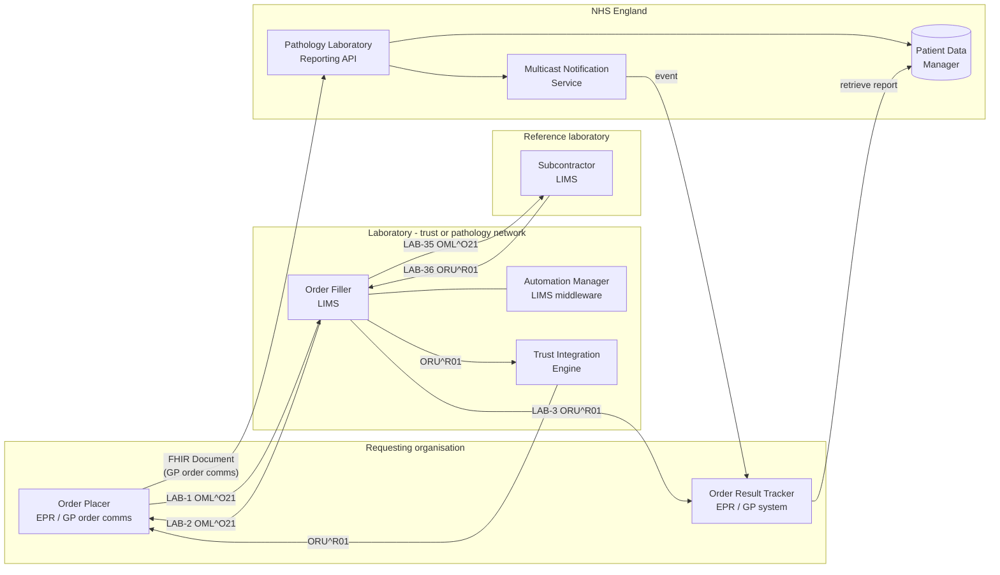

<b>Draft.</b> This implementation guide is a draft for discussion. It is <b>not</b> an
authoritative source and is not endorsed by NHS England, IHE or HL7. Check the cited
sources before using it for implementation.

IHE describes workflows in terms of **actors** (roles) rather than products. One NHS
system can play several actors, and one actor can be played by different systems in
different settings.

### IHE PaLM Actors

| Actor | Responsibility | Typical NHS systems |
|---|---|---|
| Order Placer | Creates orders, assigns the Placer Order Number, sends them to the laboratory and tracks their status | Trust EPR or order communications (order comms), GP clinical system or GP order comms (for example ICE) |
| Order Filler | Receives orders, assigns the Filler Order Number and accession number, manages them in the laboratory and produces the results | Laboratory Information Management System (LIMS) |
| Order Result Tracker | Receives results and stores them in the patient record | Trust EPR, GP clinical system, shared care record |
| Automation Manager | Manages work orders on laboratory automation and analysers (IHE LTW / LAW) | LIMS middleware |
| Requester (ILW) | A laboratory that sends a sub-order to another laboratory | Referring laboratory LIMS (for example a spoke laboratory) |
| Subcontractor (ILW) | A laboratory that performs a sub-order and returns its results | Hub, specialist or reference laboratory LIMS |
| Content Creator / Content Consumer (XD-LAB) | Creates / consumes a shareable laboratory report document | LIMS or middleware / EPR, GP system, shared care record |
{:.grid}

### England-specific Systems

| System | Role in this guide |
|---|---|
| GP order communications (order comms) | The Order Placer for GP requests, and the system that returns results to the practice. In practice the NHS England [Pathology Laboratory Reporting API](PathologyReportingAPI.html)'s *laboratory middleware system* is likely to be this system: it receives `ORU^R01` from the LIMS and sends the FHIR Document to the API |
| Trust Integration Engine (TIE) | The middleware inside a trust or pathology network. Routes LIMS messages to the EPR, to order comms (HL7 v2 `ORU^R01`) and to shared care records, and is often where HL7 v2 to FHIR conversion happens - see [Mapping](mapping.html). Not the same thing as the NHS England "laboratory middleware system" |
| Results distribution middleware | Older pattern: receives results from one or more LIMS and sends them to GP systems as Pathology Messaging EDIFACT (MEDRPT) |
| NPEx / Labgnostic | The National Pathology Exchange - laboratory to laboratory requests and results. See [ILW](ILW.html) |
| Regional shared care record | For example the Yorkshire and Humber Care Record (YHCR) or an IHE XDS community - see [Results Distribution](ResultsDistribution.html#regional-shared-care-records) |
| NHS England Pathology Laboratory Reporting API | Validates a laboratory report (FHIR Document) and stores it in Patient Data Manager |
| Patient Data Manager (PDM) | National FHIR store for the reports and their acknowledgements |
| Multicast Notification Service (MNS) | Publishes the *test result stored* event to subscribed GP systems |
{:.grid}

### Actors and Systems Together

